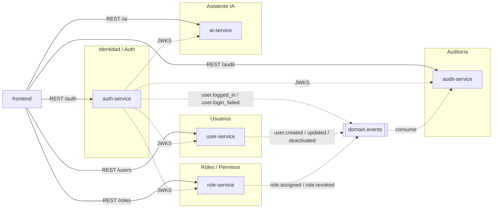
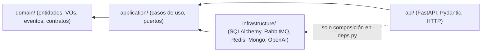
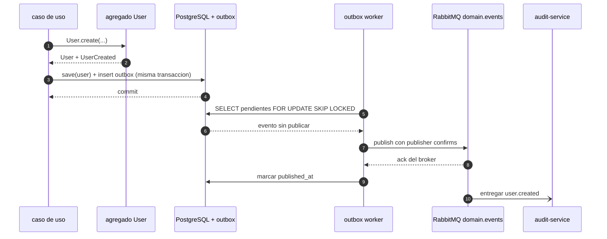
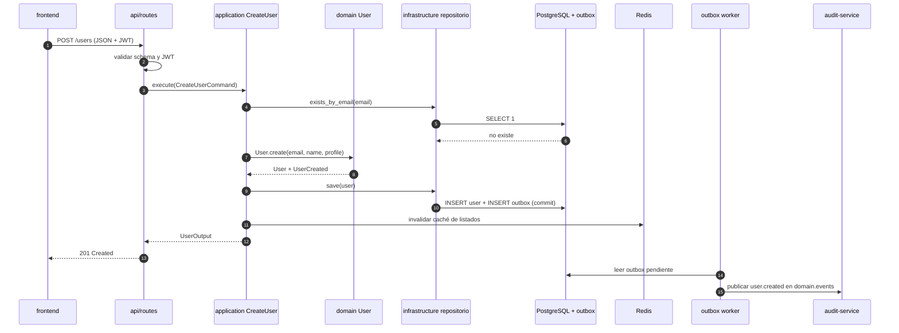

# E1.5 - DDD y Clean Architecture

Cómo se modela cada microservicio: límites de dominio, agregados y objetos de valor,
estructura de carpetas, regla de dependencias, eventos de dominio con outbox y el uso
justo de CQRS. Es el contrato que aplican los specs de implementación E2.x.

## Bounded contexts

| Contexto | Servicio | Responsabilidad | Persistencia propia |
|---|---|---|---|
| Identidad / Auth | `auth-service` | Credenciales, emisión y refresco de JWT, publicación de JWKS, revocación de `jti` | `auth_db`, Redis |
| Usuarios | `user-service` | Ciclo de vida del usuario (alta, consulta, edición, baja lógica) | `users_db`, Redis (caché) |
| Roles / Permisos | `role-service` | Catálogo de roles y permisos, asignación y revocación a usuarios | `roles_db` |
| Auditoría | `audit-service` | Consumo de eventos de dominio y consulta del registro de auditoría | MongoDB `audit_entries` |
| Asistente IA | `ai-service` | Consulta RAG: recuperación en Qdrant y generación con OpenAI | Qdrant |



No hay **shared kernel** de código: aunque `Email` se repita en Auth y Usuarios, cada
contexto define su propio objeto de valor con su validación. Compartir un paquete de
dominio acoplaría el despliegue de servicios que deben evolucionar por separado; lo único
compartido es infraestructura técnica (config, logging, esquema de errores, publicador
outbox), que no contiene reglas de negocio.

## Modelo por contexto

### Identidad / Auth (`auth-service`)

| Tipo | Elemento | Notas |
|---|---|---|
| Agregado (raíz) | `Credential` | Credenciales de acceso: `email`, `password_hash`, `status`. Es el único agregado propio del contexto |
| Entidad | `RefreshToken` | Identificado por `jti`, con `expires_at`; su revocación se guarda en Redis (E2.4) |
| Value objects | `Email`, `PasswordHash`, `TokenClaims` | `TokenClaims` encapsula `sub`, `email`, `roles`, `scope`, `iss`, `aud`, `exp`, `jti` |
| Servicio de dominio | `TokenIssuer` | Firma RS256 y compone el par access/refresh |
| Repositorios | `CredentialRepository` | Solo lectura de credenciales; las altas de usuario ocurren en otro contexto |
| Eventos | `UserLoggedIn`, `UserLoginFailed` | Se publican como `user.logged_in` y `user.login_failed` (E2.8) |

Auth no conoce el agregado `User`: valida credenciales contra su propia base y no consulta
`user-service` en el camino caliente del login (E1.3).

### Usuarios (`user-service`)

| Tipo | Elemento | Notas |
|---|---|---|
| Agregado (raíz) | `User` | `id`, `email`, `name`, `status`, `profile`, `created_at`, `updated_at` (E2.5) |
| Value objects | `UserId`, `Email`, `UserName`, `UserStatus`, `Profile` | `UserStatus` = `active` / `inactive`; `Profile` agrupa datos opcionales |
| Invariantes | email único y válido, nombre obligatorio, no reutilizar email de un usuario inactivo, baja lógica idempotente | Se validan en el agregado, no en el controlador |
| Repositorio | `UserRepository` | `get`, `list`, `exists_by_email`, `save` |
| Eventos | `UserCreated`, `UserUpdated`, `UserDeactivated` | `user.created`, `user.updated`, `user.deactivated` |

### Roles / Permisos (`role-service`)

| Tipo | Elemento | Notas |
|---|---|---|
| Agregado (raíz) | `Role` | `id`, `name`, `description`, permisos asociados (E2.7) |
| Entidad interna | `Permission` | Pertenece al agregado `Role`; se referencia por nombre (`users:write`, `ai:use`) |
| Agregado (raíz) | `UserRoleAssignment` | `user_id`, `role_id`, `assigned_at`; mantiene la asignación porque el contexto es dueño de la relación |
| Value objects | `RoleId`, `RoleName`, `PermissionName`, `AssignmentKey` | `AssignmentKey` = `(user_id, role_id)` para garantizar idempotencia |
| Repositorio | `RoleRepository`, `AssignmentRepository` | El segundo responde también `GET /users/{id}/permissions` |
| Eventos | `RoleAssigned`, `RoleRevoked` | `role.assigned`, `role.revoked` |

### Auditoría (`audit-service`)

| Tipo | Elemento | Notas |
|---|---|---|
| Agregado (raíz) | `AuditEntry` | `event_id` único, `type`, `version`, `occurred_at`, `producer`, `actor_id`, `payload`, `correlation_id` |
| Value objects | `EventType`, `ActorId`, `EventPayload` | `EventPayload` conserva el JSON original sin reinterpretarlo |
| Repositorio | `AuditEntryRepository` | `add_if_absent` (idempotente por `event_id`), `search(filtros, paginación)` |
| Eventos propios | Ninguno | Es consumidor terminal; no vuelve a publicar al broker |

### Asistente IA (`ai-service`)

| Tipo | Elemento | Notas |
|---|---|---|
| Agregado (raíz) | `AgentSession` (opcional) | Solo si se habilita el modo conversacional de E5.3; historial corto acotado |
| Entidades / DTO de dominio | `AgentRequest`, `AgentResponse`, `Source`, `Usage` | Definidos en E5.1; `Usage` acumula tokens y coste |
| Value objects | `Question`, `SimilarityScore`, `TokenUsage` | `TokenUsage` es inmutable y se devuelve al cliente |
| Puertos de salida | `VectorStore`, `LlmClient` | Implementados en `infrastructure/` con Qdrant y OpenAI |
| Eventos | Ninguno | La consulta es de solo lectura; se registra en logs, no en el bus |

## Estructura de carpetas estándar

Todos los servicios comparten la misma forma (E2.1), tomando `user-service` como ejemplo:

```text
services/user-service/
├── domain/
│   └── user/
│       ├── entity.py          # User (raíz del agregado + invariantes)
│       ├── value_objects.py   # Email, UserName, UserStatus, Profile
│       ├── events.py          # UserCreated, UserUpdated, UserDeactivated
│       ├── repository.py      # UserRepository (Protocol/ABC)
│       └── exceptions.py      # EmailAlreadyExists, InvalidUserState
├── application/
│   ├── use_cases/
│   │   ├── create_user.py
│   │   ├── get_user.py
│   │   ├── list_users.py
│   │   ├── update_user.py
│   │   └── deactivate_user.py
│   ├── ports/
│   │   ├── unit_of_work.py    # transacción + outbox
│   │   ├── outbox.py          # OutboxStore (Protocol)
│   │   └── cache.py           # ReadCache (Protocol)
│   └── dto.py                 # comandos y resultados sin framework
├── infrastructure/
│   ├── persistence/
│   │   ├── models.py          # mapeo SQLAlchemy
│   │   ├── user_repository.py # implementa UserRepository
│   │   ├── outbox_store.py    # tabla outbox_events
│   │   └── unit_of_work.py
│   ├── messaging/
│   │   ├── publisher.py       # publica en domain.events
│   │   └── outbox_worker.py   # publica pendientes con reintentos
│   └── cache/
│       └── redis_cache.py
├── api/
│   ├── routes/users.py        # HTTP: valida, mapea y delega
│   ├── schemas.py             # Pydantic (borde del sistema)
│   ├── deps.py                # composición: use case + adaptadores
│   └── errors.py              # mapeo de excepciones de dominio a HTTP
├── migrations/                # Alembic
├── tests/
├── pyproject.toml
└── main.py                    # crea la app FastAPI
```

Variantes por servicio:

| Servicio | Cambios sobre la plantilla |
|---|---|
| `auth-service` | `domain/auth/` con `Credential` y `TokenIssuer`; `infrastructure/` añade `keys/` (RS256) y `redis/` (revocación de `jti`); `api/routes` incluye `/.well-known/jwks.json` |
| `role-service` | `domain/role/` con `Role` y `UserRoleAssignment`; sin caché |
| `audit-service` | `domain/audit/` con `AuditEntry`; `infrastructure/persistence/mongo_repository.py`; consumidor en `infrastructure/messaging/consumer.py`; no hay outbox |
| `ai-service` | `domain/agent/` con `AgentRequest`, `AgentResponse`, `Source`, `Usage`; `infrastructure/vector/qdrant.py`, `infrastructure/llm/openai_client.py`; no hay persistencia transaccional ni outbox |
| `frontend` | No aplica Clean Architecture: capas `features/`, `shared/`, `store/` (E3.1) |

## Regla de dependencias

Las capas internas no conocen las externas. `domain` es el núcleo; `api` e
`infrastructure` son adaptadores.



| Capa | Puede importar | Nunca importa |
|---|---|---|
| `domain/` | Solo biblioteca estándar y `typing` | FastAPI, SQLAlchemy, Pydantic, `pika`/`aio-pika`, `redis`, `openai`, `httpx` |
| `application/` | `domain/` y sus propios puertos (`Protocol`) | FastAPI, SQLAlchemy, SDKs de infraestructura; tampoco crea clientes de red |
| `infrastructure/` | `application/ports`, `domain/`, SDKs externos | `api/` (no importa rutas ni schemas) |
| `api/` | `application/` (casos de uso y DTO) y, solo en `deps.py`, `infrastructure/` para inyectar | SQLAlchemy directamente en rutas; lógica de negocio |

- **Inyección**: `api/deps.py` es el *composition root*: construye repositorios, publicador
  y casos de uso. El caso de uso recibe interfaces, nunca instancias concretas.
- **Errores**: las excepciones de dominio se traducen a HTTP en `api/errors.py`; el caso
  de uso no conoce códigos de estado.
- **Verificación**: el criterio se puede automatizar con `import-linter` o un test que
  inspeccione imports de `domain/` y `application/` (se puede añadir en E2.10). No se
  incluye como dependencia obligatoria ahora.

## Domain events y salida a RabbitMQ

Los eventos viven en `domain/<contexto>/events.py` como clases inmutables con nombre de
negocio (`UserCreated`), no como strings. El agregado los acumula y los expone con
`pull_events()`. El caso de uso los persiste en la tabla `outbox_events` **en la misma
transacción** que el cambio de estado, y un worker los publica después.



| Aspecto | Decisión |
|---|---|
| Dónde se definen | `domain/<contexto>/events.py`, sin dependencias de infraestructura |
| Dónde se serializan | `infrastructure/messaging/serializer.py` construye el envelope `event_id`, `type`, `version`, `occurred_at`, `producer`, `payload`, `correlation_id` (E2.8) |
| Cómo salen | Outbox transaccional + worker con publisher confirms y reintentos; nunca `publish` directo dentro del caso de uso |
| Por qué outbox | Evita el caso "commit sin evento" o "evento sin commit" si el broker falla; el worker puede reintentar sin perder el hecho de negocio |
| Coste | Una tabla y un worker por servicio que publica (`auth`, `user`, `role`); latencia de milisegundos entre commit y publicación |
| Consumo | `audit-service` consume con ack manual e idempotencia por `event_id`; no publica nada de vuelta |

`audit-service` y `ai-service` no tienen outbox: el primero solo consume, el segundo no
emite hechos de negocio.

## CQRS ligero

Se separan **commands** (escriben, pasan por el agregado) y **queries** (leen, no cargan
agregados), sin llegar a dos modelos de datos ni a event sourcing.

| Dónde aplica | Command | Query |
|---|---|---|
| `user-service` | `CreateUser`, `UpdateUser`, `DeactivateUser` → agregado + outbox | `GetUser`, `ListUsers` → consulta directa con caché Redis (E2.6) |
| `role-service` | `CreateRole`, `UpdateRolePermissions`, `AssignRoleToUser`, `RevokeRoleFromUser` | `ListRoles`, `GetUserRoles`, `GetUserPermissions` |
| `auth-service` | `Login`, `Refresh`, `Logout` | `GetJwks` (solo claves públicas) |
| `audit-service` | Escritura = consumidor de RabbitMQ | `GET /audit` sobre índices de MongoDB |
| `ai-service` | `AskAgent` (efecto: consumo de tokens) | No aplica: no hay proyección persistida |

**Por qué no se sobre-diseña**: no hay proyecciones materializadas, ni bus de comandos, ni
event sourcing. El volumen de la prueba no justifica sincronizar un read model aparte, y
la caché Redis (E2.6) ya resuelve la latencia de lectura. Se evita el coste de mantener
dos escrituras coherentes a cambio de una ganancia que no se mide.

## Ejemplo completo: `CreateUser`

Caso de uso del contexto Usuarios atravesando las cuatro capas.

1. **api** — `POST /users` recibe `UserCreateRequest` (Pydantic), valida tipos y longitudes,
   y construye el comando `CreateUserCommand(email, name, profile)`.
2. **api/deps.py** — inyecta `CreateUserUseCase` con `SqlAlchemyUserRepository`,
   `SqlAlchemyUnitOfWork` y `SqlAlchemyOutboxStore`.
3. **application** — el caso de uso comprueba `exists_by_email`, instancia `User.create(...)`
   (el dominio valida email y nombre) y abre la unidad de trabajo.
4. **domain** — `User.create` genera `UserCreated` y lo deja pendiente; ninguna regla vive
   fuera del agregado.
5. **infrastructure** — el repositorio inserta la fila, el outbox guarda el evento con el
   mismo `commit`, y Redis invalida los listados cacheados.
6. **api** — mapea el agregado a `UserResponse` y responde `201`.
7. **worker** — publica `user.created` en `domain.events` y marca el evento como publicado.
8. **audit-service** — el consumidor inserta `AuditEntry` de forma idempotente por `event_id`.



Errores esperados en el borde: email inválido → `400`; email ya registrado → `409`; sin
token o scope → `401`/`403`; fallo de base de datos → `503` controlado, sin filtrar SQL.

## Justificación de capas y patrones

| Elemento | Problema que resuelve |
|---|---|
| `domain/` aislado | Las reglas de negocio se prueban sin base de datos ni red; un cambio de framework no las toca |
| `application/` con casos de uso | Orquesta el agregado y los puertos; deja explícito el flujo de cada operación y su transacción |
| Puertos (`Protocol`) | Permiten sustituir PostgreSQL por un doble en tests y evitan que el caso de uso dependa del driver |
| `infrastructure/` | Concentra SQLAlchemy, RabbitMQ, Redis, Mongo y OpenAI; cambiar de proveedor no toca dominio ni casos de uso |
| `api/` delgada | Traduce HTTP ↔ DTO y errores; si la ruta crece, es señal de negocio filtrado |
| Agregados | Garantizan invariantes (email único, transiciones de estado) en un solo lugar |
| Value objects | Validan al construirse (`Email`, `UserStatus`); evitan strings sueltos inválidos |
| Outbox | Elimina la doble escritura no atómica entre base de datos y broker |
| Eventos de dominio | El hecho de negocio se nombra en el dominio; el transporte (RabbitMQ) es un detalle de infraestructura |
| CQRS ligero | Lecturas rápidas y cacheadas sin cargar agregados, sin el coste de un read model separado |
| Caché Redis | Reduce latencia y carga de PostgreSQL en lecturas repetidas (E2.6), con degradación si cae |

## Notas y supuestos

- `UserRoleAssignment` como agregado propio en `role-service` es una propuesta de
  modelado: E2.7 exige las operaciones de asignación y la consulta de permisos, y alguien
  debe ser dueño de esa relación. Se confirma al implementar E2.7.
- `AgentSession` queda **opcional** y solo si E5.3 habilita el modo conversacional.
- `RefreshToken` se modela como entidad de Auth con estado en Redis; el detalle de
  revocación por `jti` se implementa en E2.4.
- No se introduce un bus de comandos ni un contenedor de dependencias externo: FastAPI
  `Depends` + `deps.py` cubre la composición.
- La verificación automática de la regla de dependencias (`import-linter`) queda como
  mejora opcional para E2.10.
