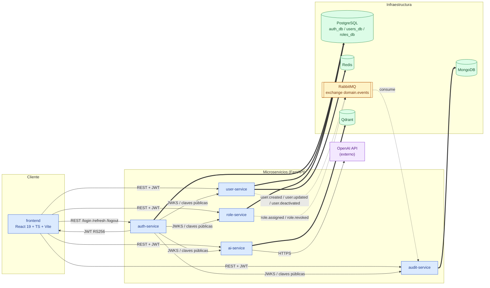
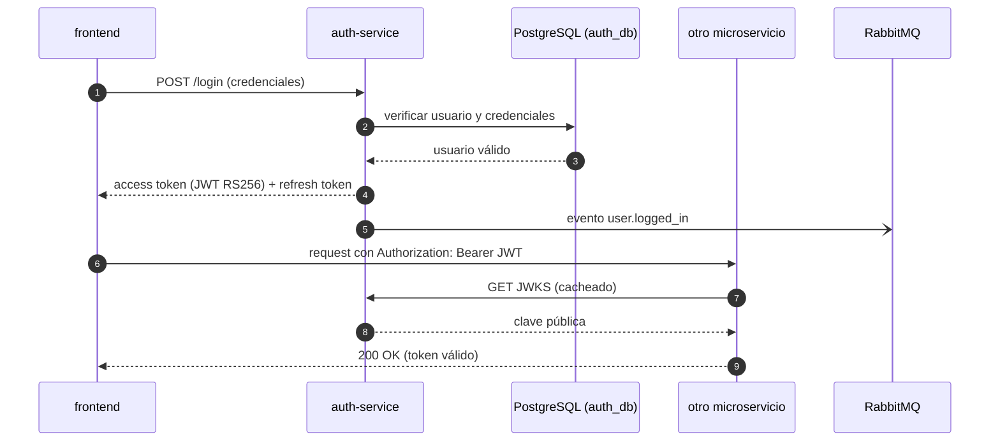

# E1.1 - Diagrama de arquitectura

Diagrama principal del sistema de gestión de usuarios. Fija los nombres de servicios,
bases de datos y canales de comunicación que referencian el resto de specs.

## Diagrama principal

## Flujo de autenticación (JWT)

`auth-service` es el único emisor de tokens: firma JWT con clave privada RS256 y expone
las claves públicas vía JWKS. El resto de servicios validan el token localmente (firma y
claims) descargando/cacheando el JWKS, sin llamada por request a `auth-service`.

## Leyenda

| Estilo | Significado |
|---|---|
| Línea sólida con flecha (`-->`) | Comunicación síncrona REST/HTTP (o HTTPS hacia servicios externos) |
| Línea punteada (`-.->`) | Comunicación asíncrona vía RabbitMQ, exchange `domain.events` |
| Línea gruesa (`==>`) | Acceso a datos desde un servicio (PostgreSQL, MongoDB, Redis, Qdrant) |
| Rectángulo azul | Servicio de aplicación (cliente o microservicio) |
| Cilindro verde | Almacenamiento de datos |
| Rectángulo amarillo | Broker de mensajería |
| Rectángulo morado | Servicio externo de terceros |

## Comunicaciones representadas

| Origen | Destino | Tipo | Detalle |
|---|---|---|---|
| frontend | auth-service | REST | Login, refresh y logout |
| auth-service | frontend | REST | Emisión de JWT RS256 y refresh token |
| frontend | user-service, role-service, audit-service, ai-service | REST | Peticiones con `Authorization: Bearer <JWT>` |
| auth-service | user-service, role-service, audit-service, ai-service | REST | Distribución de claves públicas (JWKS) |
| ai-service | OpenAI API | REST/HTTPS | Generación de respuestas (E5.x) |
| user-service | RabbitMQ | Evento | `user.created`, `user.updated`, `user.deactivated` (E2.5) |
| role-service | RabbitMQ | Evento | `role.assigned`, `role.revoked` (E2.7) |
| auth-service | RabbitMQ | Evento | `user.logged_in`, `user.login_failed` (E2.8) |
| RabbitMQ | audit-service | Evento | Consumo para persistir auditoría (E2.9) |
| auth-service | PostgreSQL | Datos | `auth_db` |
| user-service | PostgreSQL | Datos | `users_db` |
| role-service | PostgreSQL | Datos | `roles_db` |
| audit-service | MongoDB | Datos | Colección de auditoría |
| user-service | Redis | Datos | Caché de lecturas e invalidación (E2.6) |
| ai-service | Qdrant | Datos | Vectores para RAG (E5.2, E5.3) |

## Notas y supuestos

- PostgreSQL se dibuja como un único nodo con tres bases (`auth_db`, `users_db`,
  `roles_db`), una por bounded context; en el compose son instancias lógicas separadas
  (E2.2).
- RabbitMQ expone el exchange topic `domain.events` con colas de `audit-service` y
  dead-letter `domain.events.dlq` (E2.2).
- Redis aparece únicamente asociado a `user-service` (caché de lecturas, E2.6). El flujo
  de login lo menciona como opcional en E1.3, por lo que no se dibuja como dependencia de
  `auth-service`.
- Los nombres de eventos se toman de `specs/e2-05-user-service-crud.md`,
  `specs/e2-07-role-service.md` y `specs/e2-08-eventos-rabbitmq.md`; el contrato y la
  versión del payload se fijan en E2.8 (ver `flujos-de-datos.md`).
- OpenAI se representa como servicio externo, no como contenedor del `docker-compose`.
