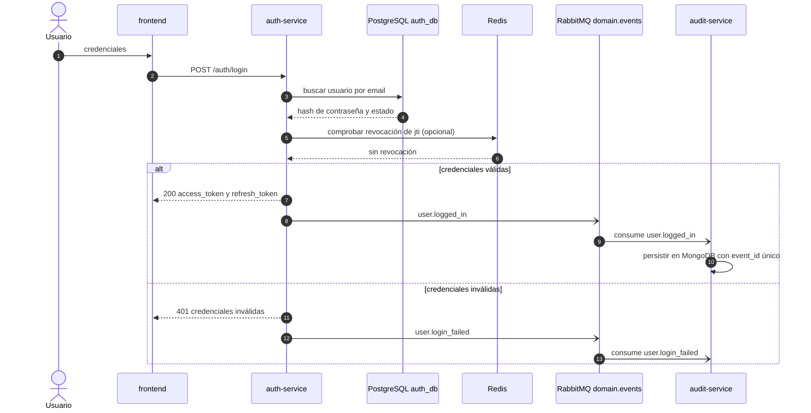
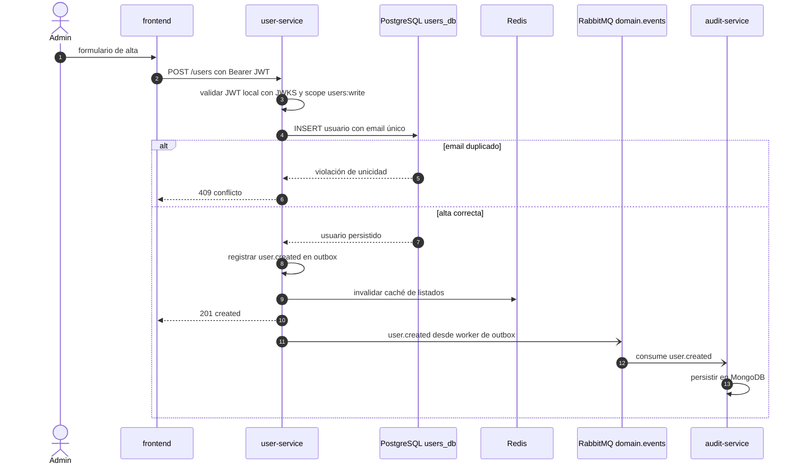
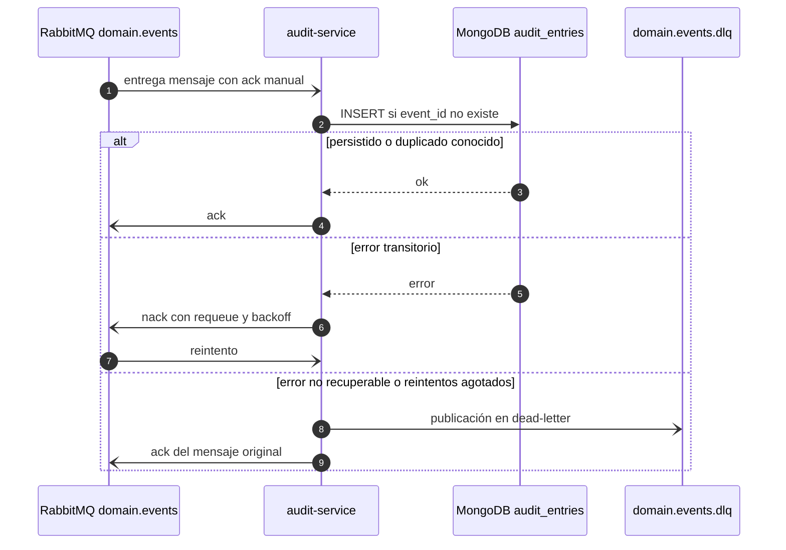
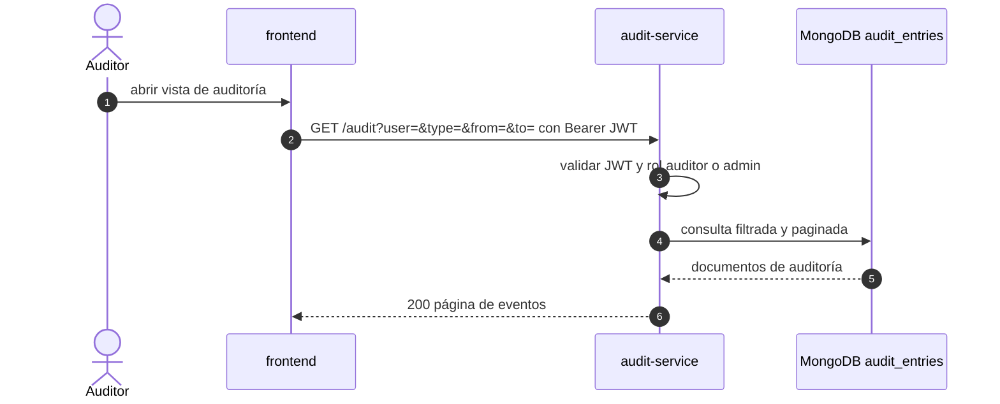
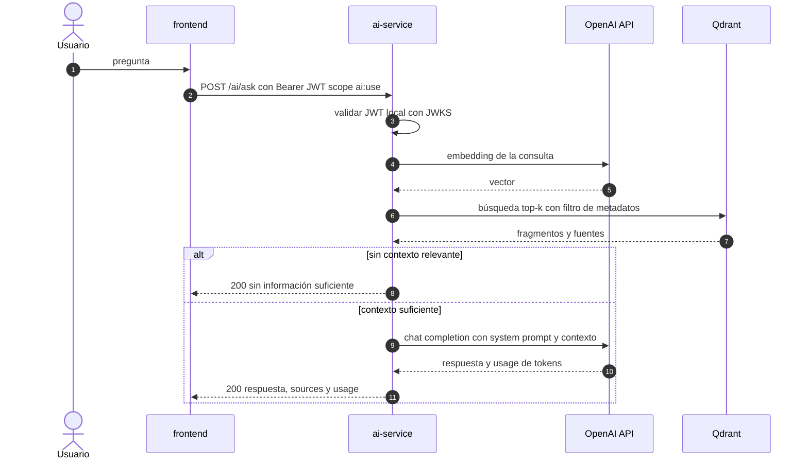

# E1.3 - Flujo de datos entre microservicios

Flujos síncronos (REST) y asíncronos (RabbitMQ) del sistema, con puntos de idempotencia y
reintento. Los nombres de servicios, almacenes y eventos coinciden con E1.1 y con los
specs de implementación E2.4, E2.5, E2.7, E2.8 y E2.9.

## Envelope de eventos

Todos los eventos viajan por el exchange topic `domain.events` con el mismo sobre
(versionado, definido en E2.8):

```json
{
  "event_id": "0f4c9b1e-2f4a-4c62-9a6a-6f0f2f3c9d11",
  "type": "user.created",
  "version": 1,
  "occurred_at": "2026-10-20T14:32:11.482Z",
  "producer": "user-service",
  "payload": { "user_id": "8b1d...", "email": "ana@example.com" },
  "correlation_id": "req-7f3a91"
}
```

`event_id` es la clave de idempotencia de extremo a extremo: el productor lo genera una
sola vez por hecho de negocio y el consumidor lo usa para descartar duplicados.

## Flujo 1 - Login

`frontend -> auth-service -> PostgreSQL (Redis opcional) -> JWT`.



- **Síncrono**: un único salto HTTP del front al `auth-service`; el resto del sistema no
  participa en el login.
- **Redis (opcional)**: se usa para revocar `jti` en logout (E2.4) y validar refresh
  tokens. Si no responde, el login sigue funcionando con el camino PostgreSQL.
- **JWT**: el `auth-service` firma RS256; los servicios validan localmente con JWKS
  (E2.4), sin llamada en cada request.
- **Idempotencia**: `POST /auth/login` no es idempotente por diseño (cada intento emite
  un `jti` nuevo). Reintentar credenciales inválidas no tiene sentido; solo se reintenta
  ante error 5xx o timeout de red.
- **Reintentos**: ninguno automático en el cliente HTTP; el front reintenta manualmente.
  La publicación del evento va por outbox (E2.8), así que un fallo del broker no pierde
  `user.logged_in`.

## Flujo 2 - Alta de usuario

`frontend -> user-service -> PostgreSQL` + evento `user.created` a RabbitMQ.



- **Síncrono**: el `201` se devuelve cuando el usuario está en PostgreSQL; la auditoría
  ocurre después, sin bloquear la respuesta.
- **Idempotencia**: la unicidad de `email` hace detectable el reintento (409), por lo que
  no se crean duplicados. El consumidor descarta eventos repetidos por `event_id`.
- **Reintentos**: el worker de outbox reintenta publicar con backoff si RabbitMQ falla;
  el evento permanece en la tabla de outbox hasta confirmarse.

## Flujo 3 - Auditoría

`RabbitMQ -> audit-service -> MongoDB` y consulta desde el front.

### 3.1 Consumo de eventos



- **Idempotencia**: índice único en `event_id` + `INSERT` condicional; reenviar el mismo
  evento no duplica registros (E2.9).
- **Reintentos**: `nack` con requeue y backoff acotado; al agotarse los intentos el
  mensaje termina en `domain.events.dlq` para análisis manual, sin perderse.

### 3.2 Consulta desde el front



- **Idempotencia**: `GET` es de solo lectura, seguro de reintentar.
- **Reintentos**: el front reintenta una vez ante timeout o 502/503, sin backoff
  ilimitado; el servidor usa `limit`/`offset` para mantener la consulta acotada.

## Flujo 4 - Consulta IA

`frontend -> ai-service -> Qdrant + OpenAI -> respuesta`.



- **Síncrono**: dos llamadas a OpenAI (embedding y generación) más una a Qdrant dentro de
  la misma petición.
- **Idempotencia**: consulta de solo lectura; repetirla consume tokens de nuevo, no
  produce efectos de negocio.
- **Reintentos**: backoff exponencial ante timeout, `429` y `5xx` de OpenAI (E5.1); si se
  agotan, se devuelve error controlado al front, nunca un 500 sin contexto.

## Tabla de eventos

Exchange `domain.events` (topic, durable). Consumidor actual: `audit-service`. El topic
permite añadir consumidores futuros sin tocar a los productores.

| Nombre | Versión | Productor | Consumidor | Payload (JSON) |
|---|---|---|---|---|
| `user.logged_in` | 1 | `auth-service` | `audit-service` | `{"user_id":"uuid","email":"ana@example.com"}` |
| `user.login_failed` | 1 | `auth-service` | `audit-service` | `{"email":"ana@example.com","reason":"invalid_credentials"}` |
| `user.created` | 1 | `user-service` | `audit-service` | `{"user_id":"uuid","email":"ana@example.com","name":"Ana","status":"active"}` |
| `user.updated` | 1 | `user-service` | `audit-service` | `{"user_id":"uuid","email":"ana@example.com","name":"Ana","status":"active","updated_at":"2026-10-20T14:32:11Z"}` |
| `user.deactivated` | 1 | `user-service` | `audit-service` | `{"user_id":"uuid","status":"inactive"}` |
| `role.assigned` | 1 | `role-service` | `audit-service` | `{"user_id":"uuid","role_id":"uuid"}` |
| `role.revoked` | 1 | `role-service` | `audit-service` | `{"user_id":"uuid","role_id":"uuid"}` |

Listado alineado con E2.8 (eventos de `auth-service`), E2.5 (`user.created`,
`user.updated`, `user.deactivated`) y E2.7 (`role.assigned`, `role.revoked`).

## Matriz de idempotencia y reintentos

| Flujo | Operación | Idempotencia | Reintentos | Efecto de un duplicado |
|---|---|---|---|---|
| Login | `POST /auth/login` | No (emite `jti` nuevo) | Solo manual ante 5xx/timeout | Token adicional válido hasta su `exp` |
| Login | publicación `user.logged_in` | Sí, por `event_id` + outbox | Worker de outbox con backoff | El consumidor lo ignora |
| Alta de usuario | `POST /users` | Sí, por email único | Manual ante 5xx/timeout | `409 conflicto`, no crea duplicado |
| Alta de usuario | publicación `user.created` | Sí, por `event_id` + outbox | Worker de outbox con backoff | El consumidor lo ignora |
| Auditoría | consumo de eventos | Sí, por índice único `event_id` | `nack` con requeue y backoff | No inserta una segunda entrada |
| Auditoría | `GET /audit` | Sí (solo lectura) | Un reintento desde el front | Sin efecto |
| IA | `POST /ai/ask` | No (consume tokens) | Backoff ante 429/5xx/timeout | Respuesta repetida y coste duplicado |

## Notas y supuestos

- **Redis en el login**: E1.1 no dibuja Redis para `auth-service`; aquí se marca como
  opcional porque E2.4 solo lo necesita para revocar `jti` en logout. Sin Redis, el login
  sigue funcionando y la revocación queda deshabilitada.
- **`user.deleted` vs `user.deactivated`**: E1.1 usaba `user.deleted`; el agregado de E2.5
  aplica soft delete (`DeactivateUser`), así que el evento canónico es `user.deactivated`.
- **Payload mínimo**: los campos mostrados son los necesarios para auditar. El contrato
  quedó fijado en E2.8: envelope con `event_id`, `type`, `version` entero `1`, `occurred_at`,
  `producer`, `payload` y `correlation_id`.
- **`reason` en `user.login_failed`**: confirmado en E2.8 como `invalid_credentials` para
  credenciales inválidas, usuario inactivo y email desconocido (sin revelar cuál se dio).
- **Eventos de user/role**: E2.8 implementó el envelope, el publicador y los eventos de
  `auth-service`; `user.created`/`user.updated`/`user.deactivated` y
  `role.assigned`/`role.revoked` se publicarán al implementar E2.5/E2.7 con el mismo patrón
  de outbox.
- **Sin cache en la consulta IA**: no está especificado en E5.x, así que cada pregunta
  genera llamadas reales a OpenAI.
